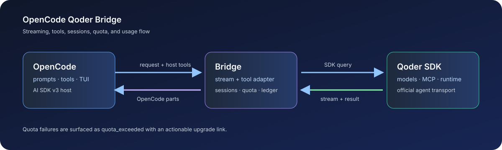
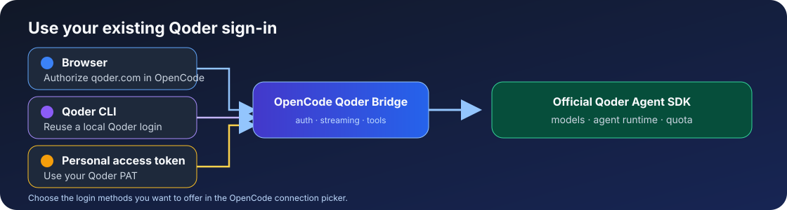
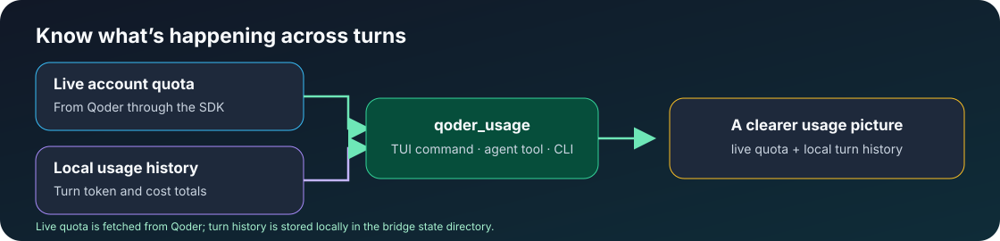

# opencode-qoder-bridge

[](https://github.com/naoufalelbani/opencode-qoder-bridge/actions/workflows/ci.yml)
[](https://github.com/naoufalelbani/opencode-qoder-bridge/actions/workflows/security.yml)
[](https://www.npmjs.com/package/opencode-qoder-bridge)
[](https://www.npmjs.com/package/opencode-qoder-bridge)
[](./LICENSE)
[](./SECURITY.md)
[](https://nodejs.org/)

Run Qoder models in [OpenCode](https://opencode.ai) with the official
[`@qoder-ai/qoder-agent-sdk`](https://www.npmjs.com/package/@qoder-ai/qoder-agent-sdk).
Stream responses and tool calls, sign in with browser OAuth, your Qoder CLI, or
a personal access token, and check live quota alongside local usage history.

**OpenCode 1 + 2 · Official SDK · Flexible sign-in · Live quota · Local usage ledger**

This bridge is for OpenCode users who want Qoder's official agent runtime,
OpenCode-managed tools and MCP, and local usage history in one integration. It
supports Qoder global and CN accounts through browser sign-in or the matching
Qoder CLI login, including guided Qoder CN enterprise VPC browser sign-in. If
you use magpie, see
[@magpie-community/opencode-qoder-auth](https://www.npmjs.com/package/@magpie-community/opencode-qoder-auth),
which supports OpenCode and magpie. The two plugins both register the `qoder`
provider, so use one at a time.

[Quick start](#quick-start) · [Features](#highlights) · [Security](#security)



OpenCode owns the host tools and user experience; this bridge translates prompts,
stream events, tool calls, session state, quota, and usage metadata to and from
the official Qoder SDK.

> [!IMPORTANT]
> This is an independent community project. It is not affiliated with,
> endorsed by, or sponsored by Qoder or OpenCode. Use of the Qoder SDK and
> services is subject to the [Qoder Product Service Terms](https://qoder.com/product-service).

## What's new in v0.4.0

Version 0.4.0 adds Qoder CN browser sign-in, guided CN Enterprise VPC setup,
and daily credit check-in. OpenCode 1 and 2 continue to use the official Qoder
Agent SDK runtime with browser, CLI, and personal access token login options.



- **Choose how to sign in.** Use browser sign-in, a Qoder CLI login, or a
  personal access token. Set `disableQoderCliLogin: true` to hide the CLI and
  personal-token login choices from OpenCode's Qoder connection picker while
  keeping browser sign-in available.
- **Get to chat sooner.** OpenCode 2 can start with cached or fallback models
  while the live Qoder model catalog loads in the background.
- **Use file tools reliably.** The bridge now forwards the file path field
  OpenCode 2 expects, fixing Qoder `Read` calls that previously failed with a
  missing-path error.
- **Keep one integration across OpenCode versions.** The package exposes the
  OpenCode 2 plugin and TUI interfaces while retaining the OpenCode 1 server
  plugin.
- **Use the updated SDK and dependencies.** Qoder Agent SDK 1.0.51 and refreshed
  OpenCode, AI SDK, and security dependencies are included.

## Regional browser sign-in and daily check-in

Version 0.4.0 adds browser sign-in for Qoder CN and daily credit check-in.
OpenCode 1 asks which Qoder region to use during OAuth sign-in. OpenCode 2
provides separate **Sign in with Qoder CN** and **Sign in with Qoder CN
Enterprise (VPC)** connection methods. CN browser
accounts use the official `@qodercn-ai/qodercn-agent-sdk`; if Qoder refuses to
exchange the device token for a job token, the bridge uses and refreshes the CN
device token directly. Run `/qoder_checkin` to claim daily credits. Global
accounts also need Qoder desktop or CLI's `runtime-info` helper for Qoder's
native campaign identity; set `QODER_RUNTIME_INFO` if it is installed elsewhere.

Together, these updates make setup more flexible, bring model selection up
sooner, and make OpenCode 2 file operations work with the expected tool schema.
Usage history, live quota, sessions, MCP support, and cost reporting remain part
of the same integration.

## Highlights

- **One plugin for OpenCode 1 and 2** — keep your Qoder setup across supported OpenCode generations.
- **Official Qoder runtimes** — uses Qoder's regional Agent SDK for model requests and agent features; no vendored or patched SDK copies.
- **Sign in your way** — use browser authorization for qoder.com or qoder.cn, an existing regional Qoder CLI login, or a personal access token.
- **Tools that work with OpenCode** — streams text and reasoning, hands Qoder tool calls to OpenCode host tools, and bridges configured MCP servers.
- **See account and session usage** — query live Qoder quota and inspect local per-turn token and cost history with `qoder_usage` or the statusline command.
- **Claim daily credits** — run `qoder_checkin` for the browser-signed-in Qoder account.
- **Start with models quickly** — OpenCode 2 can register cached or built-in models before live discovery finishes.
- **Handle images and long sessions** — accepts common local image paths and data URLs; supports configurable session persistence, abort propagation, and bounded runtime limits.



## Quick start

1. Use Node.js 22.22.2 or newer, or Node.js 24.15.0 or newer.

2. Install OpenCode:

   ```bash
   npm install -g opencode-ai
   ```

3. Add the plugin to `~/.config/opencode/opencode.json` (OpenCode 2):

   ```json
   { "plugins": ["opencode-qoder-bridge"] }
   ```

   OpenCode downloads the plugin from npm when it starts. You do not need to
   install the plugin globally or in a separate project first. OpenCode 1
   uses the singular `plugin` key; see [Install](#install).

4. Sign in to Qoder from OpenCode:

   ```bash
   opencode auth login qoder --method oauth
   ```

   Authorize the URL shown in your browser. You can also open the OpenCode
   connection picker and choose **Qoder (opencode-qoder-bridge)**, then select
   a Qoder sign-in method. For CN enterprise accounts, choose
   **Sign in with Qoder CN Enterprise (VPC)** and enter your instance name
   (for example, `acme`) or its HTTPS VPC address. The VPC is saved with that
   browser credential, so requests and refreshes continue to use the matching
   private endpoints.
   OpenCode stores the job token and refresh token in its auth store; the bridge
   refreshes them before SDK requests. Choose Qoder CN in the sign-in prompt to
   authorize a qoder.cn account. CN device tokens are refreshed through the CN
   token endpoint when Qoder does not issue a job token.

   Alternatively, authenticate with a Qoder PAT. Create it at
   [Qoder account integrations](https://qoder.com/account/integrations), then
   set it in the environment of the shell that launches OpenCode:

   ```bash
   export QODER_PERSONAL_ACCESS_TOKEN="pt-..."
   opencode
   ```

   Or use the Qoder CLI login flow:

   ```bash
   qoder login
   ```

   If the SDK reports that its runtime is missing, follow the
   [SDK runtime installation](#sdk-runtime-installation) steps. A separately
   installed Qoder CLI can provide the runtime as a fallback.

### Security

The [Security and dependency audit workflow](https://github.com/naoufalelbani/opencode-qoder-bridge/actions/workflows/security.yml)
runs npm dependency auditing, builds the package, checks the installable npm
artifact, and scans tracked files for accidental credentials on pull requests
and pushes to `main`. See the [security policy](./SECURITY.md) for private
vulnerability reporting and credential-handling notes.

Browser credentials are stored by OpenCode and refreshed for SDK requests. The
usage ledger and the device token used by daily check-in are stored in the
bridge state directory with mode `0600` where the operating system supports
POSIX file permissions. Keep
`bypassPermissions` for trusted, disposable workspaces only; OpenCode remains
responsible for confirming and executing host-tool actions.

The bridge uses the official SDK build for the selected Qoder region. A PAT
takes first priority. When a matching Qoder CLI login is present, the bridge
uses that login by default, matching the account and authentication path used
by `qoder` in a terminal. If there is no CLI login, a saved OpenCode browser
sign-in is used.
Set `QODER_AUTH_MODE=browser` to use the saved browser sign-in when both are
present, or `QODER_AUTH_MODE=cli` to require the CLI path. The package includes
both regional SDKs because they target separate Qoder hosts.

### Qoder CN region

Both global and CN regions work with this same package — no separate install.
Use the matching browser sign-in method or log in with the regional CLI:

- Global: `qoder login` → `~/.qoder/.auth/user`, binary `qodercli`
  (`~/.qoder/local/`, `~/.qoder/bin/qodercli/`, or `PATH`).
- CN: CN-CLI login → `~/.qoder-cn/.auth/user`, binary `qoderclicn`
  (`~/.qoder-cn/local/`, `~/.qoder-cn/bin/qoderclicn/`, or `PATH`).

For OpenCode 1, `opencode auth login qoder --method oauth` asks which region to
use; choose the separate **Qoder CN Enterprise (VPC)** sign-in method to enter
an enterprise instance. In OpenCode 2, choose the matching Qoder CN sign-in in
the connection picker. For enterprise browser accounts, select **Sign in with
Qoder CN Enterprise (VPC)** and enter the instance name or HTTPS address. Discovery
order is `QODER_CLI_PATH` override → `PATH` (`qodercli`, then `qoderclicn`
per directory) → `~/.qoder/local` → `~/.qoder-cn/local` → latest versioned
binary across both `bin/` directories. If both regions are installed, global
takes precedence on ties; versioned binaries otherwise resolve to the latest
version. To force one region, set `QODER_REGION=global|cn` (default `auto`)
or pin `QODER_CLI_PATH` to an explicit executable. The `qoder_usage` report
shows the detected region, and `QODER_BRIDGE_DEBUG=1` logs the resolved CLI
path and region. For CN CLI VPC/scene accounts, the existing `QODER_SCENE`,
`QODERCN_VPC_ENDPOINT` (also `QODER_VPC_ENDPOINT`, `QODER_API_URL`)
environment variables are honored for model discovery. Browser sign-in can
instead save a VPC endpoint on the account and use it for chat, refresh,
usage, and check-in requests.

### SDK runtime installation

With npm 12, dependency install scripts may be blocked by the consuming
project's script-approval policy. To download the SDK's bundled Worker
runtime, approve and rebuild each SDK from that project:

```bash
npm install-scripts approve @qoder-ai/qoder-agent-sdk
npm rebuild @qoder-ai/qoder-agent-sdk
npm install-scripts approve @qodercn-ai/qodercn-agent-sdk
npm rebuild @qodercn-ai/qodercn-agent-sdk
```

If you use a separately installed `qoder` CLI or intentionally set
`QODER_SKIP_DOWNLOAD=1`, this step is not required; the bridge can use that
runtime fallback instead.

## Install

The bridge supports **OpenCode 2** and **OpenCode 1** from a single package.

For a published npm installation on OpenCode 2, add this to
`~/.config/opencode/opencode.json` (or `opencode.jsonc`):

```json
{
  "plugins": ["opencode-qoder-bridge"]
}
```

For a local checkout or an unpublished package, create
`.opencode/plugins/qoder-bridge.js` in the project and re-export the built
plugin entry:

```js
export { default } from "file:///absolute/path/to/opencode-qoder-bridge/dist/index.js";
```

OpenCode 2 discovers plugins in `.opencode/plugins/`; the file URL must be an
absolute path to the checkout's built `dist/index.js`.

OpenCode 2 options live under `providers.qoder.settings` and are equivalent to
OpenCode 1's `provider.qoder.options`:

Set `disableQoderCliLogin` to `true` to hide the Qoder CLI and personal-token
login methods from OpenCode's Qoder connection picker. Browser OAuth remains
available. The option defaults to `false`.

```json
{
  "plugins": [
    {
      "package": "opencode-qoder-bridge",
      "options": { "sessionKey": "my-project" }
    }
  ],
  "providers": {
    "qoder": {
      "settings": {
        "sessionPersistence": true,
        "disableQoderCliLogin": true
      }
    }
  }
}
```

On OpenCode 1 use the singular `plugin` key instead; both loaders read the same
entry point:

```json
{
  "plugin": ["opencode-qoder-bridge"]
}
```

opencode installs published npm plugins automatically on startup. A bare package
name must exist in the npm registry; installing an unpublished package only in
`~/.config/opencode/node_modules` is not enough for current opencode releases.
Once loaded, the plugin injects the `qoder` provider and all models — no manual
`provider` block required.

### Verify the installation

After changing the plugin or its configuration, restart OpenCode and verify
that the provider is available:

```bash
opencode models qoder
opencode run -m qoder/auto "Reply with one short sentence."
```

For a local checkout, rebuild before restarting OpenCode:

```bash
npm run build
```

Then use the `.opencode/plugins/qoder-bridge.js` wrapper shown above. This
avoids OpenCode loading an older cached copy of the package.

### Authenticated E2E tests

The authenticated E2E test is opt-in because it consumes Qoder quota:

```bash
QODER_E2E=1 npm run test:e2e
```

The GitHub Actions `Authenticated Qoder E2E` workflow can be started manually
after adding a `QODER_PERSONAL_ACCESS_TOKEN` repository secret. Normal pushes
and pull requests never run this quota-consuming job.

## Usage

```bash
opencode run -m qoder/lite "say hello"      # free model
opencode run -m qoder/auto "explain async/await"
opencode -m qoder/performance               # interactive
```

### Usage & cost

Run `qoder-usage` in a terminal for the live report, or add the statusline
binary to your OpenCode statusline config:

```bash
opencode-qoder-bridge
# qoder: cost $0.0123 · turns 1 · tok 1500 · last performance
```

The package also exports a TUI entry at `opencode-qoder-bridge/tui`. It shows
live Qoder credits only while the current session's selected provider is
`qoder`; it stays hidden and does not query quota for other providers. The
sidebar shows OpenCode's session spend with four-decimal precision and derives
fractional session Credits from Qoder's cent-denominated reference cost
(`session.cost * 100`). The value is marked with `~` because Qoder's personal
SDK exposes only a rounded whole-account quota, not its per-request Credits Log.
The authoritative account balance still comes from SDK `userQuota`, refreshing
after each completed Qoder turn and every 30 seconds while active.

On OpenCode 1, the server plugin and the TUI plugin load independently. On its
first load, the bridge safely adds its bundled TUI entry to the global
`~/.config/opencode/tui.json`, preserving existing settings. Restart OpenCode
once after initial installation so the TUI loader can activate it. The regular
TUI loads these commands; OpenCode's `--mini` interface does not load external
TUI plugins in current releases. The resulting entry is equivalent to:

```json
{
  "$schema": "https://opencode.ai/tui.json",
  "plugin": ["file:///path/to/opencode-qoder-bridge/dist/tui.js"]
}
```

OpenCode 2 loads the bundled sidebar on its own from the `tui` entry point, so
no `tui.json` entry is needed. When OpenCode 2 migrates an existing `tui.json`
plugin list into its own `plugins` list, the sidebar's activation guard makes
sure only one copy renders.

The ledger accumulates across sessions. Delete `~/.config/opencode-qoder-bridge/usage.json` to reset it.

## Models

The bridge discovers the available catalog at startup through the SDK's
`getAvailableModels()` API. Availability is account-, region-, rollout-, and
SDK-version-dependent. A permanent allowlist is intentionally not embedded
here because the catalog is account- and scene-dependent.

There is intentionally no static model table here. Model availability is
account-, region-, plan-, scene-, SDK-version-, and rollout-dependent, and the
SDK's live catalog is authoritative for selectable IDs, capabilities, context
limits, and pricing.

Run `opencode models qoder` to inspect the models currently registered with
OpenCode. The `qoder_models` tool also exposes capabilities, context limits,
and price multipliers to the agent. On each plugin startup, the bridge performs
bounded live discovery automatically; if Qoder is unavailable, it uses the
last catalog for the same credential/deployment context and the built-ins.

## Configuration

Bridge opencode MCP servers into the SDK by passing provider options:

```json
{
  "provider": {
    "qoder": {
      "options": {
        "extraArgs": { "--experimental-mcp-load": null }
      }
    }
  }
}
```

Flag names may be written with or without the leading `--`.

`config.mcp` servers are bridged into the SDK's `mcpServers` automatically.
Chat turns have a 30-minute bridge inactivity timeout by default; the watchdog
resets whenever Qoder emits a stream or tool message, so long active coding
turns are not killed solely because they cross 30 minutes. Set
`options.timeoutMs` to a positive value to use a shorter or longer bounded
inactivity timeout (up to 24 hours).
The bridge also enforces a two-hour absolute wall-clock limit by default so a
noisy or non-terminating SDK stream cannot run forever. Set
`options.maxDurationMs` to change it (up to seven days). These are transport
safety limits; OpenCode remains responsible for retries, cancellation UX, and
host session orchestration.
Control operations such as MCP status and OAuth use the SDK's
`controlRequestTimeoutMs` (default 60 seconds, bounded to 5 minutes), while
runtime shutdown uses `closeGraceMs` (default 2 seconds). A separate
`initTimeoutMs` budget (default 60 seconds, bounded to 10 seconds through 5
minutes) aborts a wedged runtime that yields no first message, instead of
waiting out the inactivity timeout. Set `options.maxTurns` to cap SDK agent
turns per chat turn (positive integer; defaults to the SDK value), and
`options.goalMaxTurns` for SDK goal pursuits. Set `options.sdkDebug` to
forward `--debug` to qodercli; its stderr is captured into the bridge debug
log whenever `QODER_BRIDGE_DEBUG=1` regardless. These options tune
Qoder SDK lifecycle behavior only; OpenCode continues to own host session and
UI lifecycle. Values in `options.env` override inherited process variables rather than
replacing the complete child environment.

### Persistent sessions and permissions

Session persistence is opt-in. Give a provider configuration a stable
`sessionKey` and enable `sessionPersistence`:

```json
{
  "provider": {
    "qoder": {
      "options": {
        "sessionPersistence": true,
        "sessionKey": "my-project-main"
      }
    }
  }
}
```

Mappings are stored in
`~/.config/opencode-qoder-bridge/sessions.json` with restrictive file
permissions and are scoped to the configured working directory. The plugin
uses OpenCode's project directory when available; set `options.cwd` when
loading the provider directly. Use the `qoder_session_reset` tool to forget
the mapping. A new session is created automatically if the mapping does not
exist; existing sessions are resumed through the Qoder SDK.

Qoder-native and bridged MCP tools remain provider-owned. If OpenCode supplies
a function with a colliding native name, the bridge derives a Qoder deny rule
to avoid executing the same operation in both runtimes.

The bridge uses the SDK's safer permission policy by default. To explicitly
allow all Qoder tools in a trusted local environment, configure for example:

```json
{
  "provider": {
    "qoder": {
      "options": {
        "permissionMode": "default",
        "allowedTools": ["Read", "Glob", "Grep"]
      }
    }
  }
}
```

Available permission modes are `default`, `acceptEdits`, and
`bypassPermissions`. Only explicitly configure `bypassPermissions` when the
host environment is trusted.

#### File editing and shell access

Qoder's `Read`, `Write`, `Edit`, `Glob`, `Grep`, and `Bash` calls are translated
into OpenCode tool calls. The bridge must not deny these host tools by default:
if they are denied, Qoder may report that it cannot edit files even though the
OpenCode project permissions would allow it. Configure an explicit allowlist
only when you intentionally want to restrict the agent:

```json
{
  "provider": {
    "qoder": {
      "options": {
        "permissionMode": "default",
        "allowedTools": ["Read", "Write", "Edit", "Glob", "Grep", "Bash"]
      }
    }
  }
}
```

For a trusted disposable workspace, `bypassPermissions` can be used for an
unattended build:

```json
{
  "provider": {
    "qoder": {
      "options": {
        "permissionMode": "bypassPermissions",
        "allowDangerouslySkipPermissions": true
      }
    }
  }
}
```

Do not use that mode for untrusted repositories or prompts. OpenCode remains
responsible for executing the translated host tools; the bridge only carries
the tool calls between Qoder and OpenCode.

If generated code is displayed as plain text, that is a model-response
formatting issue rather than a file-tool issue. Ask Qoder to use Markdown code
fences in its explanation; files written through `Write` and `Edit` are not
formatted by the bridge. Run the project's formatter separately when one is
configured.

Image inputs may reference `file://`, `~/`, or absolute local paths. Only pass
paths from trusted callers: the bridge bounds image size but does not sandbox
or restrict readable local files to the project directory. A current turn is
limited to 64 images and 40 MiB of decoded image data; excess attachments are
reported as omitted text.

### Plan Mode

Plan Mode instructs Qoder to analyze and plan changes without modifying files
or running action tools. It operates independently from tool permissions,
preserving your configured `permissionMode`:

```json
{
  "provider": {
    "qoder": {
      "options": {
        "planMode": true
      }
    }
  }
}
```

The plugin automatically registers the following local TUI slash commands in
OpenCode. No manual `opencode.json` edits are required; restart OpenCode after
installing or updating the plugin, then select the command from the `/`
autocomplete list:

The implementations remain registered, but the TUI marks commands as hidden
when their prerequisites are absent; it does not disable or delete them. With
the default configuration, `/qoder_usage`, `/qoder_models`, and
`/qoder_checkin` appear.
Session commands appear when session persistence, `sessionKey`, or `sessionId`
is configured. MCP commands appear when at least one MCP server is configured.
`/qoder_plan_mode` remains hidden because it currently provides guidance only.

| Command | Arguments | Purpose |
|---------|-----------|---------|
| `/qoder_usage` | none | Show live quota and local cost/token totals. |
| `/qoder_checkin` | none | Claim daily credits for the browser-signed-in account. |
| `/qoder_models` | none | List available Qoder models and capabilities. |
| `/qoder_sessions` | optional directory and/or limit | List recent Qoder sessions. |
| `/qoder_session_reset` | optional key, or `all` | Reset persisted session mappings. |
| `/qoder_session_fork` | optional session ID, directory, title, cutoff | Create an independent session branch. |
| `/qoder_mcp_status` | none | Inspect MCP connection and OAuth status. |
| `/qoder_mcp_auth` | server, then optional callback URL | Start or complete MCP OAuth. |
| `/qoder_plan_mode` | none | Show Plan Mode status and configuration guidance. |

These commands execute in the TUI and show their result in a modal box. They do
not create an LLM turn or consume model tokens. Commands that accept arguments
open a local input box first. The same names are also registered as tools for
agent use, which is a separate model-driven path.

### Proxy & Network Routing

Pass an outbound proxy URL directly to the Qoder runtime without mutating host
environment variables (supports `http://`, `https://`, `socks5://`, and `socks://`):

```json
{
  "provider": {
    "qoder": {
      "options": {
        "proxy": "http://127.0.0.1:8888"
      }
    }
  }
}
```

If `proxy` is omitted, the bridge automatically falls back to `HTTPS_PROXY` or
`HTTP_PROXY` from your environment.

### Memory

Memory is opt-in. Native mode lets Qoder consume project/user memory and run
turn-completion generation while keeping generated content under Qoder's own
memory controls:

```json
{
  "provider": {
    "qoder": {
      "options": {
        "memory": {
          "mode": "native",
          "projectScope": true,
          "userScope": false
        }
      }
    }
  }
}
```

The bridge waits up to 10 seconds for Qoder's memory/evolution background work
after a successful turn, then closes the query. A slow or failed background
operation is logged in debug mode and does not fail the user turn.

### Security Scan

Security checks are opt-in and disabled unless explicitly configured:

```json
{
  "provider": {
    "qoder": {
      "options": {
        "securityScan": {
          "l1StaticCheck": true,
          "l2LightweightScan": true,
          "l3DeepScan": false
        }
      }
    }
  }
}
```

L1 runs after supported edits; L2/L3 enable repository scans. These checks do
not replace the bridge's permission policy and may consume additional Qoder
credits.

### MCP OAuth and session forks

Use `qoder_mcp_status` to inspect configured server state. For a server with
`needs-auth`, run `qoder_mcp_auth` without `callbackUrl`, open the returned
authorization URL, then run it again with the complete OAuth callback URL.
The bridge keeps the initialized SDK query alive for this two-step flow and
expires it after ten minutes.

Use `qoder_session_fork` to create an independent local transcript branch.
The active provider mapping is intentionally unchanged; continue the returned
session ID explicitly when you want to work on the fork.

### Skill Evolution

Enable autonomous turn-completion skill analysis and recommendations:

```json
{
  "provider": {
    "qoder": {
      "options": {
        "evolution": {
          "skill": { "mode": "native" }
        }
      }
    }
  }
}
```

### Available Tools

The plugin registers several built-in OpenCode tools:

- `qoder_usage` — Live account balance, quota percentages, and local cost ledger totals.
- `qoder_checkin` — Claim daily credits for the browser-signed-in account.
- `qoder_models` — List known Qoder models, context limits, vision/reasoning flags, and multipliers.
- `qoder_sessions` — List recent Qoder sessions, session IDs, branches, and timestamps via SDK `listSessions()`.
- `qoder_session_reset` — Forget the persisted Qoder session mapping for the active project.
- `qoder_session_fork` — Fork a local Qoder transcript without changing the active mapping.
- `qoder_mcp_status` — Show MCP connection, tool-count, and OAuth state.
- `qoder_mcp_auth` — Start or complete active MCP OAuth authentication.
- `qoder_plan_mode` — View Plan Mode status and configuration guidance.

## Troubleshooting

| Problem | Solution |
|---------|----------|
| Auth prompt at startup | Run `qoder login` (global) or the CN-CLI login (creates `~/.qoder-cn/.auth/user`), then restart opencode |
| Qoder runtime unavailable | Authenticate with `qoder login` or set `QODER_PERSONAL_ACCESS_TOKEN`; the bridge uses the SDK's bundled Worker runtime for model discovery and can fall back to an installed CLI automatically |
| Qoder says it cannot read or edit files | Upgrade to the current bridge, rebuild it if using a checkout, confirm the plugin points at `dist/index.js`, and restart OpenCode. Do not add `Read`, `Write`, `Edit`, or `Bash` to `disallowedTools` unless you intend to block them |
| `invalid JSON for tool read/write` | Use a current bridge build and restart OpenCode so an old cached plugin is not reused. Recent versions normalize Qoder's streamed empty-input prefix before forwarding the complete tool payload |
| `Quota: 0/0` or quota is not visible | Qoder reports an exhausted account as `total: 0` with `isQuotaExceeded: true`; use `/qoder_usage` or `qoder-usage` to see the explicit exhausted state and upgrade link. This is an account quota condition, not a stream/parser error |
| Edits work but the response is not in a code box | Tool execution and response formatting are separate. Ask for fenced Markdown in the response and use the repository's formatter for written files |
| Model not found | Run `opencode models qoder` or `/qoder_models`; model IDs are account- and scene-specific |
| Missing models in the model list | Restart OpenCode; the bridge performs a live catalog lookup automatically and falls back to the last scoped catalog plus the built-ins (`lite`, `auto`, `performance`) when offline. If your account serves models in a different Qoder scene, set `QODER_SCENE` before launching OpenCode |

The SDK package currently used by this bridge (`1.0.45` or newer) bundles its
own qodercli runtime. If the bridge discovers a
separately installed qodercli first, update that CLI through its normal Qoder
CLI installer too so the MCP OAuth and oversized-image compaction fixes are
active on that path.

### How model discovery works

At startup the bridge performs a bounded live catalog discovery from Qoder
before returning the provider configuration (`fetchStrategy: "live"` — the
bundled Worker runtime re-queries the server, with an automatic installed-CLI
fallback when necessary). Each successful catalog snapshot replaces
previously discovered dynamic IDs, so retired models do not remain selectable.
A failed, empty, or slow refresh falls back to the last scoped catalog and the
built-ins; no `qodercli --list-models` command or manual model configuration is
required. The startup wait is bounded to 10 seconds, after which OpenCode
continues with the available cache/fallbacks.

## Development

```bash
npm install
npm run build      # compile to dist/
npm run typecheck  # type-check only
npm test           # build and run the test suite
npm run test:stress # deterministic stress suite; live abort stress is opt-in
npm run test:e2e   # authenticated real-CLI test; requires QODER_E2E=1
npm run check      # full pre-publish verification
```

### Diagnostics

Set `QODER_BRIDGE_DEBUG=1` before launching opencode to emit detailed bridge
logs (model fallbacks, stream aborts, live catalog discovery, ledger and
session-store I/O failures). Warnings that need attention are always printed.

When debugging tool access, search the OpenCode log for tool calls, malformed
inputs, and permission decisions:

```bash
rg -n "tool-call|invalid_tool_input|permission" \
  ~/.local/share/opencode/log/opencode.log
```

For a local checkout, confirm which plugin file is loaded by using a `file://`
URL in `opencode.json`; package-name installs may resolve an older cached copy.
The bridge prints its active model and session information when debug logging
is enabled.

State files (usage ledger, session mapping, model cache) live under
`~/.config/opencode-qoder-bridge` by default; override with
`QODER_BRIDGE_STATE_DIR`, or relocate via `XDG_CONFIG_HOME`.

The end-to-end test is intentionally opt-in because it starts Qoder and may
consume account quota. Run it only after `qoder login`:

```bash
QODER_E2E=1 npm run test:e2e
```

To include the live concurrent-abort probe in the stress suite, set
`QODER_STRESS_E2E=1` as well as a valid Qoder credential.

The deterministic stress suite does not require a Qoder account. It exercises
large prompts, concurrent session operations, stream boundaries, tool-call
deduplication, malformed input handling, and cost-ledger concurrency. The
authenticated E2E suite starts the real Qoder runtime and may consume quota,
so run it separately when you specifically need an end-to-end provider check.

## Security

Report suspected vulnerabilities privately as described in
[SECURITY.md](./SECURITY.md). Do not include Qoder credentials, npm tokens, or
private prompt content in reports.

Maintainer release instructions are in [RELEASING.md](./RELEASING.md).
Release history is recorded in [CHANGELOG.md](./CHANGELOG.md).

## License

The bridge source is MIT licensed; see [LICENSE](./LICENSE). Dependencies retain
their own licenses and terms; see [THIRD_PARTY_NOTICES.md](./THIRD_PARTY_NOTICES.md).
